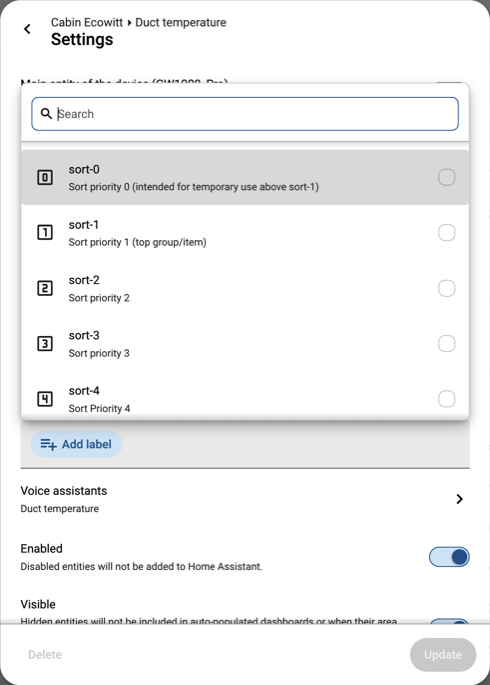
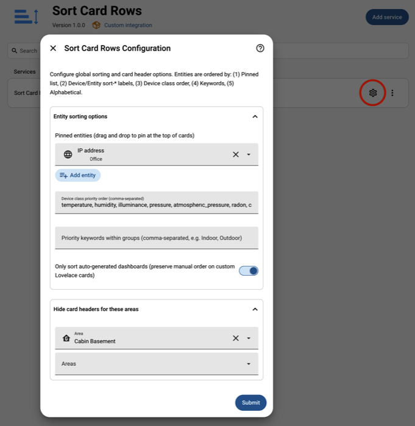
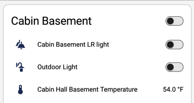
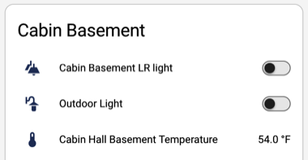

# Sort Card Rows

A lightweight Home Assistant frontend integration **to position the most important controls and sensors first**.

**Sort Card Rows** lets you control the order of entity and device rows on dashboard cards—including auto-generated dashboards, such as **Overview (legacy)** and **Area** cards as well as built-in **Entities** and **Grid** cards on dashboards where multiple devices and sensors appear together in one card—and all without renaming entities just to alphabetize the dashboard rows correctly, or having to write YAML code.

## Installation

1. **Marketplace / HACS (Recommended):**
    * Open **Settings > Marketplace (or HACS)**, click the three dots (...) in the top-right corner > **Custom repositories**, and add `https://github.com/tcrgit/ha-sort-card-rows` as an **Integration**.
    * Install **Sort Card Rows**, click Setup (or **Restart Home Assistant** and add it under **Settings > Devices & Services > + Add Integration**), and **hard-refresh your browser** (`Ctrl + Shift + R` or `Cmd + Shift + R`).
2. **Manual:**
    * Copy custom_components/sort_card_rows into /config/custom_components/, **Restart Home Assistant**, and add **Sort Card Rows** via **Settings > Devices & Services > + Add Integration**.

## Usage & Configuration

* **Automatically Creates `sort-x` Labels:** During setup, the integration creates `sort-0` through `sort-9`, `sort-top` and `sort-bottom` under **Settings > Areas, labels & zones > Labels**. Just apply the label to any entity (or device) and the order immediately changes in your dashboard.
* **Configure Dialog** (**Settings > Devices & Services > Sort Card Rows > Configure**): Manage your drag-and-drop **Pinned entities** list, customize device class order, add priority keywords, toggle which types of dashboards to sort, or pick those Areas whose card header toggles should be hidden.
* **Troubleshooting:** Check your browser console (`F12` or `Cmd + Option + I`) for `[Sort Card Rows] Active (v1.x.x, ...)`.

| |
| :---: |
|  |
| *Applying a sort-x label to a switch or sensor* |

## Features & Sorting Priority

When using this integration, the rows inside supported dashboard cards are ordered using a chain of sorting rules before falling back onto Home Assistant's default alphabetization order. While some sorting may improve immediately after installation (e.g. Temperature sensors should appear before Humidity sensors), most people will likely find either the first or second sorting rule methods most useful to set their optimal dashboard row order.

The sorting rule methods are flexible and designed to work together. They are applied in the following sequence, and any ties between entities at a higher level are resolved by lower priority rules. For example: if two light switches both have `sort-2` labels, their order would likely fall through to the alphabetical tie-breaker.
1. **Pinned Entities (Drag-and-Drop):** Switch and sensor entities selected from **Pinned entities** list in the integration's **Configure** dialog sort to the top of their card. This method supports drag-and-drop ordering of the selected items.
2. **Device & Entity `sort-x` Labels:** You can sort rows by assigning entities pre-created, numeric Home Assistant labels (such as `sort-1` through `sort-9`, `sort-top`, and `sort-bottom`), use the `sort-0` label to temporarily push a row to the top, or even create custom decimal labels like `sort-1.5`:
    * **Card Row Ordering:** Attach `sort-1`, `sort-2`, `sort-top` or `sort-bottom` directly to individual switch sensor entities to immediately move them to the top or bottom of a card.
    * **Multi-Device Grouping:** Attach a `sort-x` label to a Device (including *parent* devices with multiple post-`2026.11.0` *child* devices) to keep all of its entities grouped together as a block, and attach more `sort-x` labels to its entities to order rows within that device group.
3. **Device Class Grouping:** Rows can be grouped and ordered automatically by their built-in *device class* using a configured priority list. The default device class sort order is `temperature`, `humidity`, `illuminance`, `pressure`, `atmospheric_pressure`, `radon`, `carbon_dioxide`, `battery`; but the user can edit the order and add or delete device class names. (*Note: For sensors without a built-in device class, you may create and apply a label like `sort-temperature` or `sort-pressure` to make that sensor sort like others which do have that device class.*)
4. **Priority Keywords:** Optional comma-separated keywords (for example `Outdoor, Indoor`) allow you to sort rows by any keywords found in the switch or sensor entity names, just ahead of the default alphabetization order. In this keyword example, the result would be display the `Outdoor Temperature` sensor before the `Indoor Temperature` sensor on the dashboard card (all other things being equal).
5. **Alphabetical Tie-Breaker:** Any remaining ties between entities sort alphabetically by the switch or sensor entity name. This is the default HA behavior for automatically generated cards.

| |
| :---: |
|  |
| *Configuration options* |

### Bonus Feature: Card Header Toggle Hiding

* Suppress the card title toggle switch in the header of multi-switch/light cards by selecting Areas under **Hide card headers for these areas** in **Configure**. While there are places a toggle to turn on all the switches in an area is useful, there are also many places when this is not desireable.

|  |  |
| :---: | :---: |
| *Default toggle on Area card header* | *No Area card toggle afterwards* |

* Suppress the card title toggle switch in the header of multi-switch/light cards by selecting Areas under **Hide card headers for these areas** in **Configure**. While there are places a toggle to turn on all the switches in an area is useful, there are also many places when this is not desireable .

## Support for Other Dashboard Templates

* **Where it works best:** This integration is designed for **Overview (legacy)**, **Areas** auto-generated dashboards, and standard **Entities** or **Grid** cards where multiple devices and sensors share a single card. It will also work on custom dashboards, but it can be a bit quirky in Edit mode.

### Custom Dashboard Cards Unsorted by Default

* To support the use of both automatic and custom dashboard cards **custom dashboard card rows and tiles are not sorted by default**, preserving the manual ordering you set using drag-and-drop in the Lovelace GUI editor (or in the YAML code). This allows you to attach a `sort-x` label to a sensor or switch so it sorts properly on auto-generated dashboards, while **simultaneously** leaving its position untouched on your custom dashboard cards.
* If you would like to have your sorting rules to apply to custom dashboard cards as well, uncheck **Only sort auto-generated dashboards (preserve manual order on custom Lovelace cards)** in **Configure**—note that when toggled off, your sorting rules will **override** any manual drag-and-drop or YAML ordering made in Edit mode, so disable this setting with caution.
  * *Edit mode: When sorting is enabled for custom dashboards, sorting will pause whenever you enter Edit mode. Cards and tiles will temporarily return to their underlying YAML order so they can be opened or moved normally in the editor. Sorting will resume automatically after you select Done.*

### Note on Home Dashboards (`2026.2+`)

* **Largely unaffected:**  Because Home Assistant's newer **Home Dashboard** templates use Area navigation buttons and place entities or devices into separate tile sections instead of grouping an entire room onto a list card, **Sort Card Rows** does not reorder those views.
* The only exception is when multiple entities share a single section, such as to the **Favorites** row on the Home Dashboard Overview.
